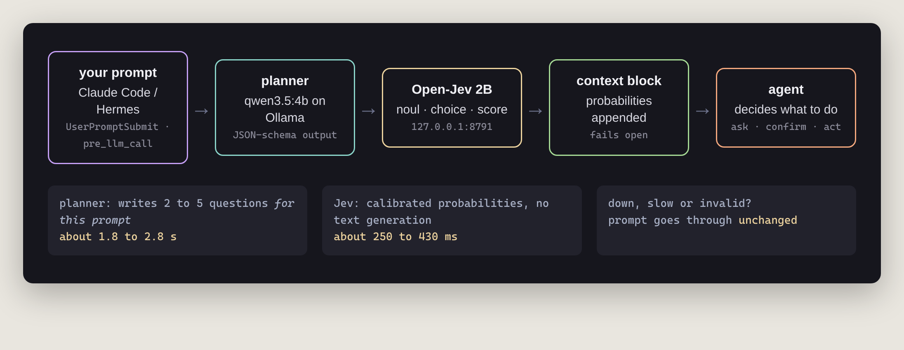
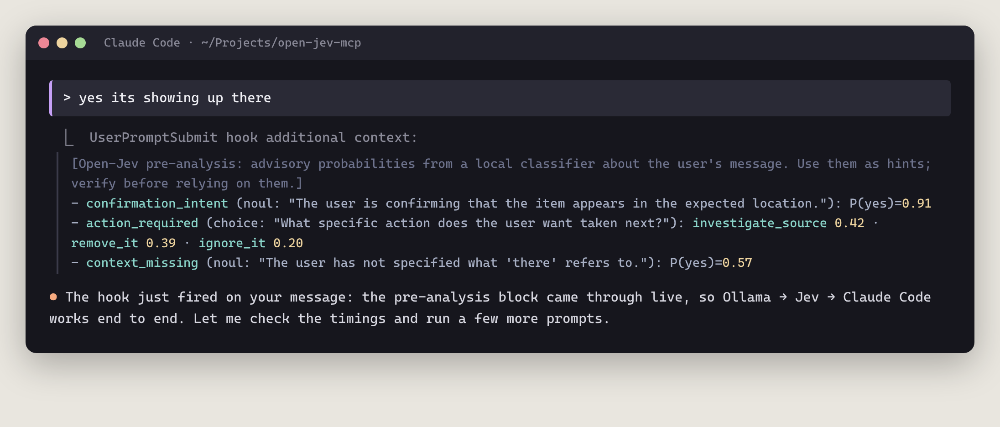
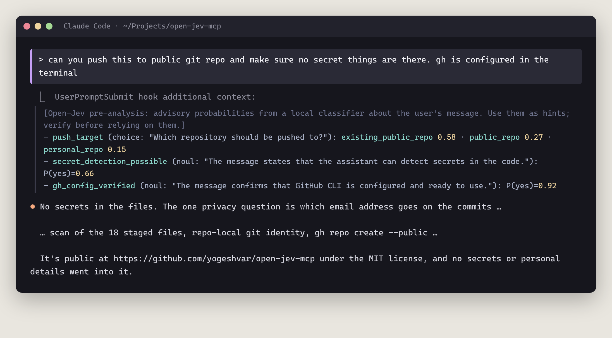
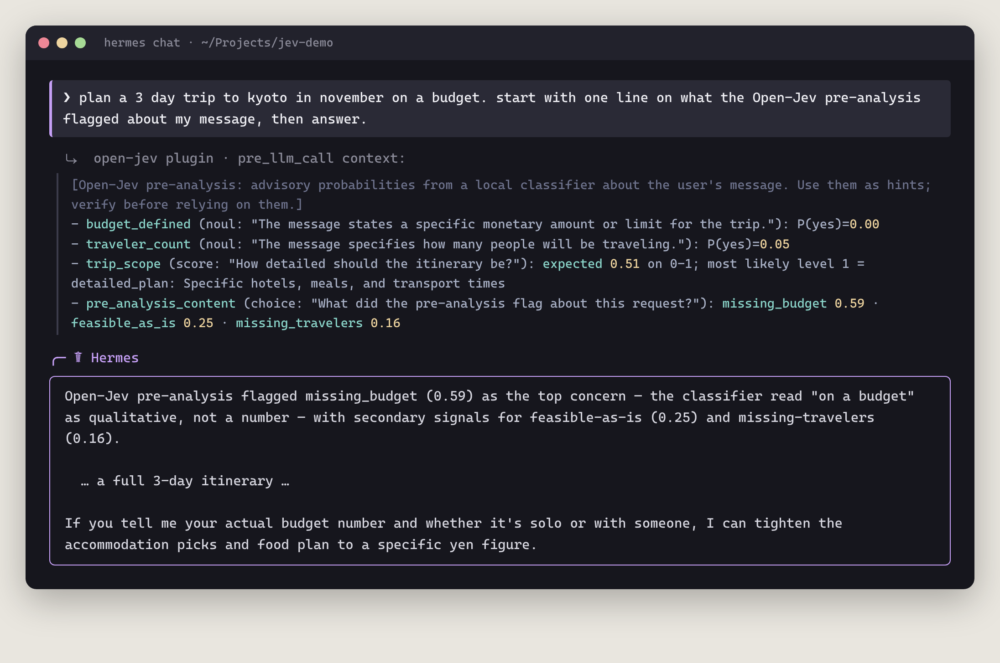
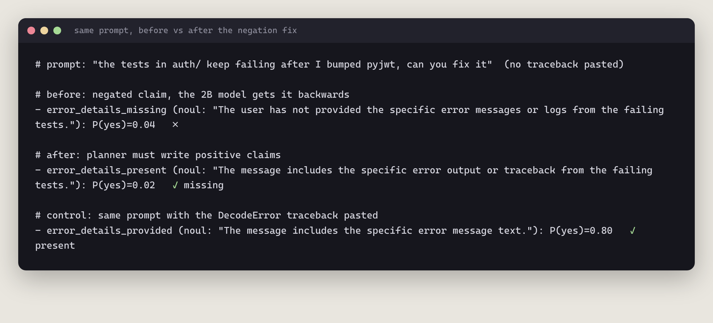
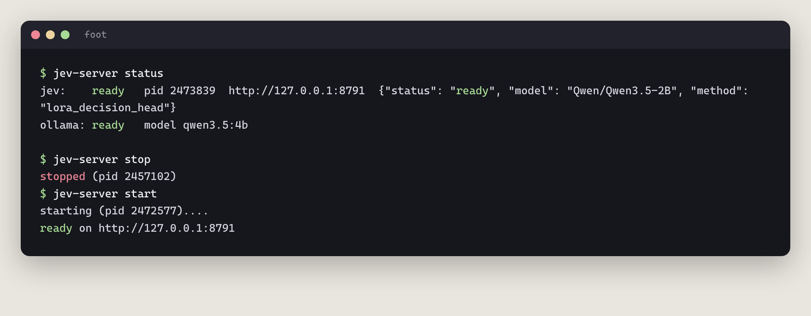
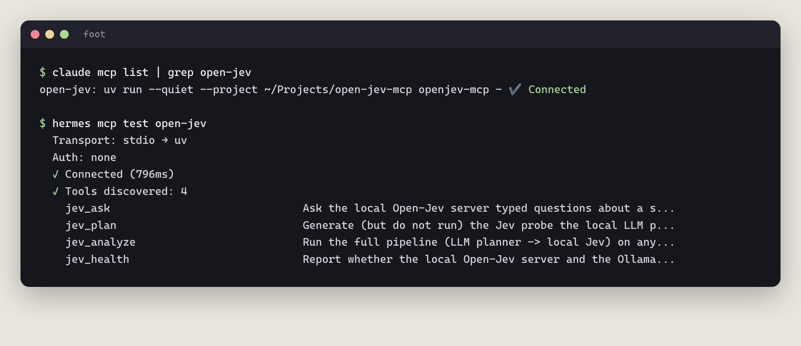
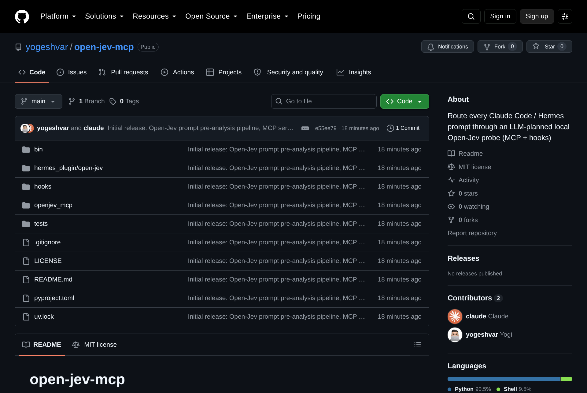

I type a lot of lazy prompts. "fix the tests". "clean up my home dir". "plan a trip on a budget". My agents are smart enough to figure most of it out. But they don't always stop and notice what I *didn't* say, or that "clean up" secretly means "delete stuff forever". 😅

So I built a tiny second opinion that runs before the agent even sees my message. Every prompt I send to Claude Code or Hermes now goes through a local classifier first, and the agent gets a little block of probabilities along with my prompt. It's open source: [yogeshvar/open-jev-mcp](https://github.com/yogeshvar/open-jev-mcp).

## Wait, what is Jev?

[TypeSafe's Jev](https://docs.typesafe.ai/introduction) is a model that doesn't write text at all. You give it some context, a few typed questions, and it hands back calibrated probabilities. There are three kinds of questions:

- **noul**: yes/no. "Is a refund requested?" → `0.96`
- **choice**: pick one label. "Which team?" → `billing 0.94 · engineering 0.06`
- **score**: a point on an ordered scale. "How urgent?" → `1.2 on 0 to 2`

[Open-Jev](https://github.com/Zefan-Cai/Open-Jev) by Zefan Cai is an open implementation of the idea: a LoRA adapter and a scoring head on top of Qwen3.5-2B that runs on my own GPU. No autoregressive generation, no parsing JSON out of a chatty model. Just numbers, fast.

## The idea: a hook on every prompt

Open-Jev is great when you know the questions. But I don't want to write questions for every prompt. The right questions for "fix my failing tests" are totally different from the ones for "plan a Kyoto trip". So the pipeline has two stages:

1. A small local LLM (`qwen3.5:4b` on Ollama) reads my prompt and writes 2 to 5 noul/choice/score questions *for that specific prompt*. The output is forced into a JSON schema and then validated against Open-Jev's own request rules.
2. Open-Jev answers them, and the result gets injected as context. The agent decides what to do with it.

*The whole pipeline is local. If anything is down or slow, the prompt just goes through unchanged.*

In Claude Code it's a `UserPromptSubmit` hook. In Hermes it's a tiny plugin using the `pre_llm_call` hook. Both call the same Python pipeline, and it fails open: if Ollama or Jev is down, nothing breaks and the prompt goes through as-is.

## What it looks like in Claude Code

The first time it fired, I was just telling Claude the server was up. Even a throwaway message gets probed:

*The first live hit. Look at `context_missing`. Hold that thought, it's lying. More on that below.*

And here it is on a real task: asking Claude to push the repo publicly without leaking anything. Jev picked up that I'd confirmed `gh` was ready (0.92), and Claude went straight to scanning the staged files for secrets before publishing:

*Rendered from the real session transcript; the reply is trimmed with “…”.*

## What it looks like in Hermes

Same pipeline, different agent. I asked Hermes for a budget Kyoto trip. Jev noticed I never gave a number (`budget_defined 0.00`) or said how many people are going (`0.05`), and Hermes closed with exactly that follow-up question:

*A real `hermes chat` run. The planner even added a meta question about the pre-analysis itself, because my prompt mentioned it. Cute.*

## The bug: a 2B model vs. the word "not"

Remember `context_missing`? Early on, the planner loved writing questions like "The user has *not* provided the error output." Totally reasonable. Except the 2B model is bad at negation. When that claim was obviously true, it said `0.04`. Backwards.

The fix was boring and it worked: the planner is now told to only write **positive** claims ("The message includes the error output"), and a validator rejects any yes/no question containing "not", "missing", "unclear" and friends, asking the planner to retry. A low probability now simply means "missing".

*Same prompt, before and after. The control (traceback actually pasted) scores 0.80, so it's really reading the message.*

## jev-server: start | stop | status

Running `python -m jev.server --checkpoint … --device cuda:0 --max-length 4096 …` in a terminal tab gets old fast. So there's a small script for it:

*`status` checks both Jev and the Ollama planner model. A warm start takes about 4 seconds.*

## It's an MCP server too

The hooks are the automatic part. The same package is also an MCP server, so both agents can call Jev on purpose: `jev_ask` for your own typed questions, `jev_analyze` to run the full pipeline on any text, `jev_plan` to see the questions without running Jev, and `jev_health`.

*Connected in both Claude Code and Hermes.*

## The numbers

- About **2 to 3 seconds** added per prompt. Most of it is the planner (1.8 to 2.8 s). Jev itself answers in 250 to 430 ms once warm.
- Both models together use about **9.9 GB** of my RTX 4070's 12 GB. It fits, but just barely.
- 11 tests, including a check against Open-Jev's own request compiler, and a fail-open test where both services are dead.

## Honest limits

- **It's a hint, not a guardrail.** "Delete anything older than a month" only scored 0.29 on "would irreversibly delete data", while `rm -rf` scored 0.95. The 2B model reacts to scary words more than to meaning.
- **Agents can ignore it.** In one Hermes run, Jev correctly said I hadn't pasted the error (0.02), and Hermes went on a 71-tool-call search of my projects anyway instead of just asking.
- **The planner still guesses sometimes**, like asking about hotel type for a trip I never described. Harmless, but it wastes a question slot.
- It adds latency to *every* prompt, including "thanks!". Short prompts and slash commands are skipped, and `OPENJEV_DISABLE=1` turns it off.

## Try it

You need an NVIDIA GPU, Ollama and uv. The README walks through setting up Open-Jev, the planner model, and wiring the hook and MCP into Claude Code and Hermes.

*[github.com/yogeshvar/open-jev-mcp](https://github.com/yogeshvar/open-jev-mcp), MIT licensed.*

Big thanks to [Zefan Cai](https://github.com/Zefan-Cai/Open-Jev) for Open-Jev, and to TypeSafe for the Jev idea. And yes, Claude Code helped me build this, while the hook was probing every message I sent it. Very meta. 🙃
