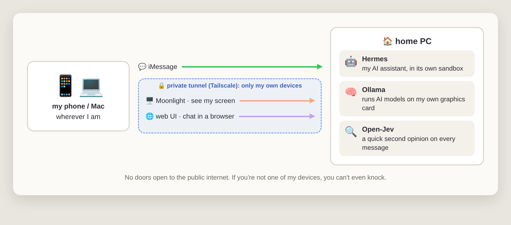
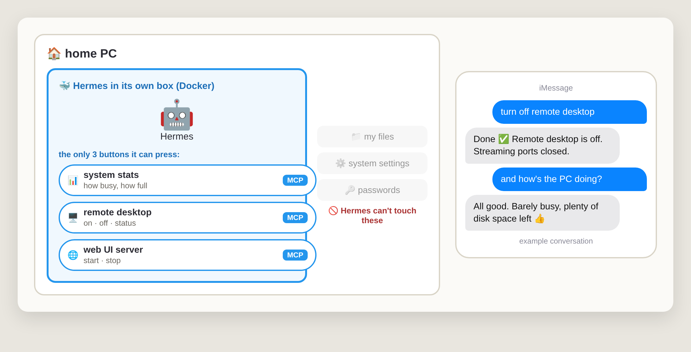
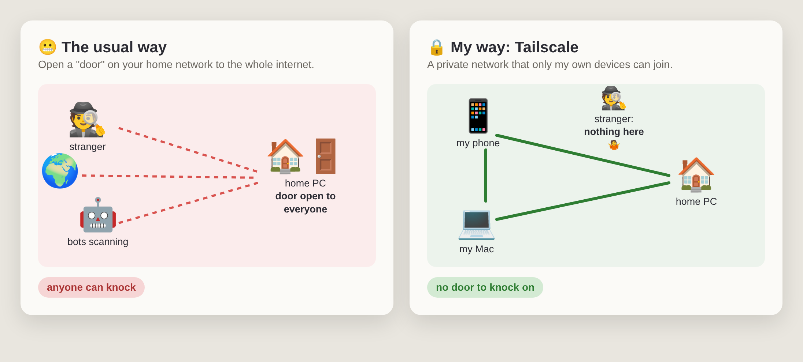
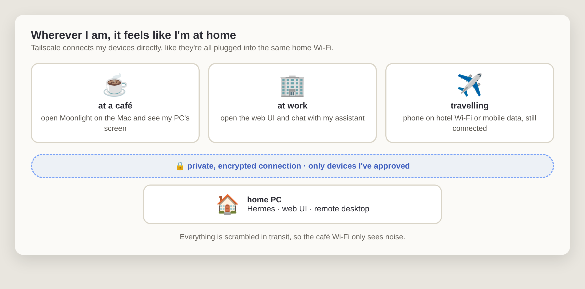

People keep asking me "wait, you text your computer?" Yes. Yes I do. 😄

I have an AI assistant that lives on a PC in my home. I can text it from my phone, open its chat in a browser, or even see the whole screen from my Mac when I'm somewhere else. No tech degree needed to follow along. I'll explain every piece in plain English.

## The big picture

*Three ways in, one box at home.*

That's the whole thing. Let's walk through it.

## Why bother?

Most AI assistants live in someone else's cloud. That's fine, until you want it to actually *do* things on your own computer, remember your stuff, or keep your conversations at home. I wanted my own assistant that runs on my own machine, is always on, and works the way I want. So I built one. Well, I assembled one. Mostly.

## The box

**What it is:** a regular desktop PC that stays on at home.

Nothing exotic: an Intel i7, 32 GB of memory and an NVIDIA RTX 4070 graphics card. The graphics card is the important part. AI models love graphics cards the way I love coffee.

It runs [Omarchy](https://omarchy.org), a flavour of Linux that looks nice right out of the box. Think of Linux as an alternative to Windows or macOS; Omarchy is just a very opinionated, very pretty version of it.

## The assistant: Hermes

**What it is:** the AI assistant itself, the part you actually talk to.

Hermes is an open-source AI agent. "Agent" just means it doesn't only chat. It can use tools: run commands, look things up, read files, remember past conversations. It runs quietly in the background all day, waiting for me to message it.

## Hermes lives in a box

**What it is:** Hermes runs inside a Docker container, which is basically a sealed room on my PC.

Here's the thing about AI agents: they can run commands. That's what makes them useful, and also what makes me a little nervous. 😅 An AI that gets confused shouldn't have the keys to my whole computer. So Hermes lives in its own box. It can do whatever it wants in there, and if it ever makes a mess, the mess stays in the room.

But a sealed room is also a bit useless. So I cut a few very specific holes in the wall. Each hole is an **MCP**, short for Model Context Protocol. Don't let the name scare you: an MCP is just a button with a label that an AI is allowed to press. Hermes can see the buttons, read what they do, and press them. It can't reach past them.

I gave it three MCPs, and each one does exactly one job:

- **System stats MCP:** how busy the PC is, how full the drives are, what's running.
- **Remote desktop MCP:** turn Moonlight on, turn it off, or check if it's on. That's it. No "run any command you like".
- **Web UI MCP:** start or stop the web UI server, the one that runs my browser chat page. More on that page below.

My files, system settings and passwords stay outside the box, out of reach.

*Three MCPs, nothing else. The chat is an example of how it goes.*

And this is my favourite trick. When I'm done using remote desktop, I don't need to be at my computer to switch it off. I just text "turn off remote desktop", Hermes presses the remote desktop MCP, and the door closes. Fewer doors open means fewer ways in. 🔒

## The brain: local AI models with Ollama

**What it is:** the AI models that do the thinking, running on my own graphics card.

Hermes needs a "brain": a language model, the same kind of thing that powers ChatGPT. [Ollama](https://ollama.com) is like an app store plus a player for AI models: you pick a model, it downloads it, and it runs it on your own hardware.

I've mostly run **Qwen** models this way, and tried Google's **Gemma** too, and honestly, it was good. Good enough that I stopped thinking about it and just used it.

The trade-offs, in one breath: running models at home is private and costs nothing per message, but you need a decent graphics card, and a model that fits on one gaming GPU isn't as smart as the giant ones in the cloud. For day-to-day stuff? More than enough.

## Texting it: iMessage

**What it is:** I talk to my assistant the same way I text a friend.

A bridge called Photon connects Hermes to iMessage. So from my phone I just open Messages and type "remind me what I was working on yesterday" or "is my PC still downloading that thing?" and it texts me back.

I even gave it a special personality for texting: short, direct, no fluff. Nobody wants a five-paragraph essay in a text bubble. 📱

## Seeing the screen from anywhere: Moonlight

**What it is:** remote desktop, meaning I can see and control my home PC's screen from another device.

The PC runs [Sunshine](https://github.com/LizardByte/Sunshine), and my Mac runs [Moonlight](https://moonlight-stream.org). Together they stream the PC's screen to wherever I am. They were built for streaming video games, which means it's *smooth*, way nicer than typical screen sharing. When I need to see what Hermes is doing, or fix something by hand, I just open Moonlight.

## The secret sauce: Tailscale

**What it is:** a private tunnel that connects only my own devices.

This is the part I'm proudest of. Normally, reaching a home computer from outside means opening a "door" to the whole internet and then hoping nobody bad walks through it. 😬

[Tailscale](https://tailscale.com) works differently. It creates a private network between my phone, my Mac and my PC, wherever they are. Remote desktop and the web chat only listen on that private network. If you're not one of my devices, the door doesn't just stay locked. It doesn't even exist.

*Strangers and bots scan the internet all day looking for open doors. With Tailscale there's no door to find.*

The best part is that it doesn't care where I am. Café Wi-Fi, the office, a hotel, mobile data: my devices find each other and talk as if they were sitting on the same home network. Everything between them is encrypted, so whoever runs that café Wi-Fi only sees scrambled noise.

*Same assistant, same screen, from anywhere. Setting it up was just installing the app on each device and signing in.*

## The web UI

**What it is:** a chat page for my assistant that opens in any browser.

Sometimes texting is too small and a full remote desktop is too much. So Hermes also has a web page. It's like a private ChatGPT page, but talking to *my* assistant on *my* PC. Same rule as before: it only works over the Tailscale tunnel. And because the web UI MCP can start or stop the server, it only runs when I actually want it. One text and it's up, another and it's gone.

## Bonus: a second opinion on every message

Every message I send gets checked first by a tiny local model that asks things like "did they forget to mention something?" or "is this about to delete stuff?" and then passes those hints to the assistant. I wrote a whole post about it: [Open-Jev MCP: Every Prompt Gets a Second Opinion](/posts/open-jev-mcp-every-prompt-gets-a-second-opinion.html).

## Should you build one?

If you're curious, here's what I'd tell a friend:

- **You need a PC that can stay on.** Ideally with an NVIDIA graphics card if you want local AI models.
- **Start with just the chat.** Get the assistant working in a browser first. iMessage and remote desktop can come later.
- **Set up Tailscale early.** It's free for personal use, and it saves you from ever opening your home network to the internet.
- **Expect to tinker.** My setup took an afternoon or three, plus a few "why is this broken at midnight" evenings.
- **Mind the power bill.** An always-on PC with a graphics card isn't free to run.

Is it overkill? Probably. Is it fun to text my own computer and have it text back? Absolutely. 🙃
